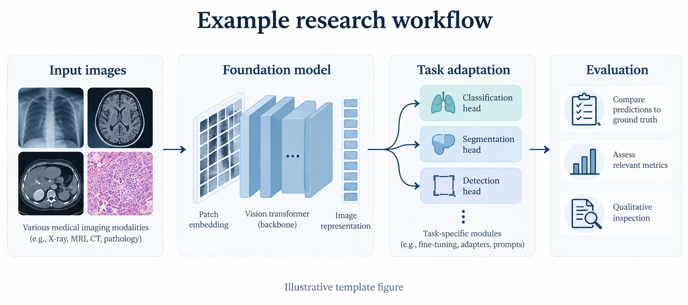

# RETFound — A foundation model for retinal images

RETFound learns representations from unlabelled retinal images using self-supervised learning. Its pretrained models can be adapted to retinal disease classification and other research tasks using colour fundus photography (CFP) or optical coherence tomography (OCT).

[Paper](https://www.nature.com/articles/s41586-023-06555-x) · [CFP weights](https://huggingface.co/YukunZhou/RETFound_mae_natureCFP) · [OCT weights](https://huggingface.co/YukunZhou/RETFound_mae_natureOCT) · [Datasets](https://github.com/rmaphoh/RETFound/blob/main/BENCHMARK.md) · [Code](https://github.com/rmaphoh/RETFound)

**A foundation model for generalizable disease detection from retinal images**  
Yukun Zhou, Mark A. Chia, Siegfried K. Wagner and colleagues · *Nature* 622, 156–163 (2023)

## Highlights

- Self-supervised pretraining on 1.6 million retinal images.
- Separate pretrained weights for CFP and OCT, with a shared fine-tuning workflow.



*Figure 1. Example figure placement. This generated illustration shows a generic healthcare AI workflow; replace it with your project's method figure. It is not a figure from the RETFound paper.* [View full-size image](images/method-overview.png).

## Getting started

### 1. Install
Install the environment and dependencies:
```bash
git clone https://github.com/rmaphoh/RETFound.git
cd RETFound
conda create -n retfound python=3.11.0 -y
conda activate retfound
pip install torch==2.5.1 torchvision==0.20.1 --index-url https://download.pytorch.org/whl/cu121
pip install -r requirements.txt
```

### 2. Get model weights and data

| Resource | Link | Use |
|---|---|---|
| CFP model | [Hugging Face model card](https://huggingface.co/YukunZhou/RETFound_mae_natureCFP) · [Checkpoint file](https://huggingface.co/YukunZhou/RETFound_mae_natureCFP/blob/main/RETFound_mae_natureCFP.pth) | Colour fundus photographs |
| OCT model | [Hugging Face model card](https://huggingface.co/YukunZhou/RETFound_mae_natureOCT) · [Checkpoint file](https://huggingface.co/YukunZhou/RETFound_mae_natureOCT/blob/main/RETFound_mae_natureOCT.pth) | OCT images |
| Benchmark datasets | [RETFound benchmark resources](https://github.com/rmaphoh/RETFound/blob/main/BENCHMARK.md#data-split) | Dataset downloads and evaluation splits |

Request access on the model page, then authenticate in the environment created above:

```bash
python -c "from huggingface_hub import login; login()"
```

For the CFP example below, prepare MESSIDOR2 with `train`, `val` and `test` folders, each containing one subfolder per class, and set the local path:

```bash
export RETFOUND_DATA="$HOME/horizon-resources/RETFound/MESSIDOR2"
```

### 3. Fine-tune and evaluate

Fine-tune:

```bash
torchrun --standalone --nproc_per_node=1 main_finetune.py \
  --model RETFound_mae --model_arch retfound_mae \
  --finetune RETFound_mae_natureCFP \
  --data_path "$RETFOUND_DATA" --nb_classes 5 \
  --input_size 224 --batch_size 24 --epochs 50 \
  --global_pool --savemodel --adaptation finetune \
  --task retfound_mae_messidor2
```

Evaluate the resulting checkpoint:

```bash
torchrun --standalone --nproc_per_node=1 main_finetune.py \
  --model RETFound_mae --model_arch retfound_mae \
  --data_path "$RETFOUND_DATA" --nb_classes 5 \
  --input_size 224 --batch_size 24 --global_pool \
  --adaptation finetune --task retfound_mae_messidor2 \
  --eval --resume ./output_dir/retfound_mae_messidor2/checkpoint-best.pth
```

## Environment and hardware

| Component | Version or requirement |
|---|---|
| Python | 3.11.0 |
| Framework | PyTorch 2.5.1; torchvision 0.20.1 |
| CUDA / CPU | CUDA 12.1 |
| Hardware and GPU memory | {{MINIMUM_HARDWARE_AND_GPU_MEMORY}} |

## Citation

If you use RETFound, please cite:

```bibtex
@article{zhou2023foundation,
  title   = {A foundation model for generalizable disease detection from retinal images},
  author  = {Zhou, Yukun and Chia, Mark A. and Wagner, Siegfried K. and others},
  journal = {Nature},
  volume  = {622},
  pages   = {156--163},
  year    = {2023},
  doi     = {10.1038/s41586-023-06555-x}
}
```

## Contact

For research enquiries, contact [Yukun Zhou](mailto:yukun.zhou.19@ucl.ac.uk).

Template prepared for [HORIZON](https://github.com/HORIZONHealthcare).
